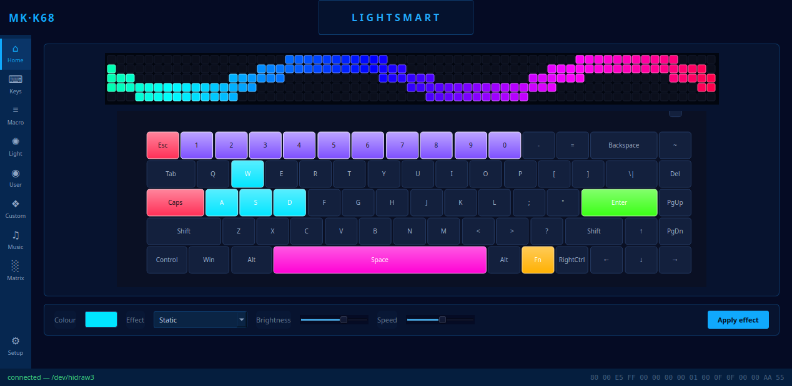
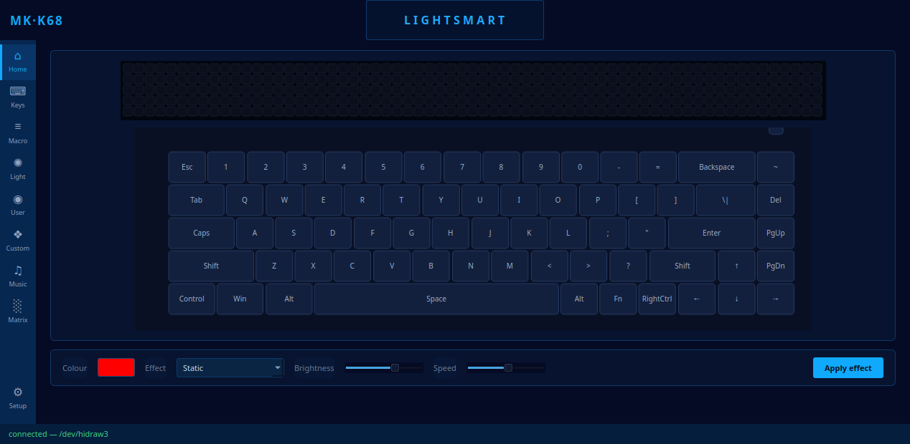
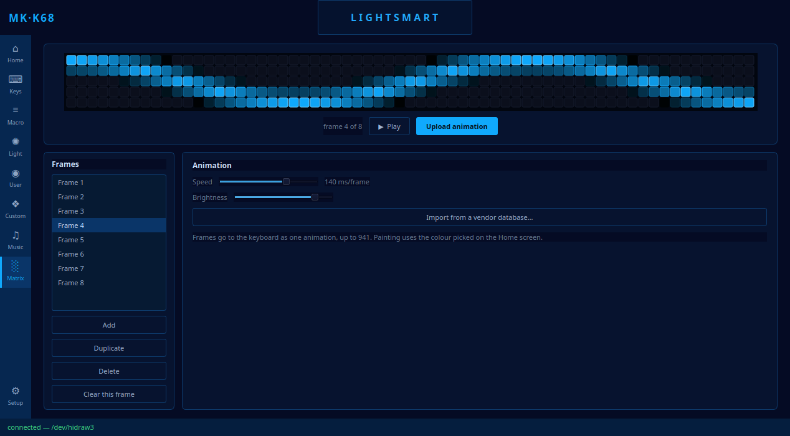

# MK-K68-LightSmart

Linux control panel for 68-key mechanical keyboards that carry a **65×5
dot-matrix LED strip** above the function row — the hardware whose vendor
software only ships for Windows.



Nothing here touches firmware. The keyboard's own configuration
protocol was reverse-engineered from the Windows driver and is spoken
over the same vendor HID interface the Windows app uses. The full
write-up, including exactly which parts are proven and which are still
inferred, is in **[docs/PROTOCOL.md](docs/PROTOCOL.md)**.

---

## The hardware

| | |
|---|---|
| USB id | `05AC:024F` — the board borrows Apple's vendor id |
| Strings | manufacturer `SONiX`, product `KT68 RGB` |
| Keys | 68 keys + a slider switch, 69 addressable LEDs |
| Strip | 65 columns × 5 rows = **325 RGB LEDs** |
| Animation limits | 941 frames, or 134 for the boot animation |
| Connection | **USB cable only** — the vendor interface is not exposed over wireless |

The keyboard presents three HID interfaces. Typing goes through the
first two; all configuration goes through the third:

| Interface | Usage page | Role |
|---|---|---|
| 0 | `0x0001` / `0x06` | boot keyboard |
| 1 | several | mouse, media keys, NKRO, plus a vendor collection (`0xFFFF`) the firmware uses to push events to the host |
| 2 | **`0xFF13`** | **the configuration channel** |

---

## Status

The transport is complete, and both lighting paths are confirmed on
real hardware: per-key colour, and the dot-matrix upload. Two of the
app's nine screens are built.

| Area | State |
|---|---|
| Device discovery by usage page, re-checked on the open fd | ✅ done |
| Feature-report transport, 15 ms pacing, ack handling | ✅ done |
| Transaction envelope | ✅ done |
| Key table, all 69 LED indices | ✅ done |
| Per-key colour | ✅ implemented, confirmed on hardware |
| Built-in animations | ✅ 20 mode bytes, confirmed on hardware; parameters still inferred |
| Dot-matrix frame upload | ✅ confirmed on hardware |
| Dot-matrix editor UI | ✅ frames, timeline, playback, import, upload |
| Key remapping | 🔍 slots and envelope decoded, records partly; nothing written to the keyboard yet |
| Macros | 🔍 opcodes located, event encoding not decoded |
| Music-reactive, settings screens | ⬜ not started |

---

## Install

### 1. udev rule

Without it the tool needs root.

```sh
sudo cp udev/60-mk-k68-lightsmart.rules /etc/udev/rules.d/
sudo udevadm control --reload-rules
sudo udevadm trigger --action=add --subsystem-match=hidraw
```

The `60-` prefix is load-bearing. The rule tags the device `uaccess`,
and the builtin that acts on that tag runs from `70-uaccess.rules` — a
`99-` rule would sort *after* it and never take effect.

The rule is scoped to **interface 2 alone**. That matters: interfaces 0
and 1 are the ones that carry the keys you type, so a rule matching only
vendor/product would hand every keystroke to any process running as the
logged-in user. This keyboard also reports Apple's `05ac:024f`, so a
broad rule would expose a genuine Apple keyboard on the same machine.

`ATTRS{bInterfaceNumber}` cannot be combined with `ATTRS{idVendor}` --
udev requires all `ATTRS` matches to land on the same parent device, and
those two live on different ones -- so the rule pins the interface with
`DEVPATH`. To check it took effect:

```sh
for n in /dev/hidraw*; do printf '%s ' "$n"; getfacl -p "$n" | grep -c "^user:$USER:"; done
```

Only the vendor interface should report `1`.

### 2. Dependencies

```sh
sudo apt install python3-pyside6.qtwidgets python3-pyside6.qtgui python3-pyside6.qtcore
```

Python 3.10 or newer. Nothing else — the transport is plain `fcntl.ioctl`.

### 3. Run

```sh
./mk-k68-lightsmart-gui     # the desktop app
./mk-k68-lightsmart info    # the CLI
```

---

## The GUI



The screen structure mirrors the Windows app: a left rail of eight
sections plus settings, a top bar, the keyboard with its strip, and a
controls row.

**What works now, on the Home screen:**

- Click the colour swatch, then click any key — the key lights on the
  keyboard and the command goes out immediately.
- The bottom-right corner shows the exact 16 bytes that were built, so
  you can watch the protocol as you click.
- The status bar reports the device node, or why it could not be found.
- Click or drag across the strip to paint it, set a brightness, and
  press Upload. A progress bar follows the blocks.
- Cancel stops the picture, but not the transfer: the firmware counts
  the blocks it was promised and ignores the host until it has them
  all, so the rest go out blank. The status bar says how many are left
  and how long that is.
- Every transfer runs on a thread of its own, so the window stays live
  through an upload that can take minutes.

### The Matrix screen



The strip's own screen. Frames are listed down the left; the selected
one is the picture you paint on, and the whole list goes to the keyboard
as one animation — up to the firmware's 941.

- **Add**, **Duplicate**, **Delete**, **Clear this frame**.
- **Play** previews the animation in the window. The pacing is local:
  how the firmware turns its speed byte into a frame rate is not known
  yet, so the preview is an approximation, not a simulation.
- **Upload animation** streams the whole thing, with the same progress
  bar and Cancel as the Home screen. 59 frames is 899 blocks, about 14
  seconds.
- **Import from a vendor database…** reads a `ledlayer_v1.data` you
  still have from the Windows installer and loads one of its layers.
  Nothing of the sort ships here.

---

## CLI

Useful for protocol work, since it sends one packet at a time.

```sh
# what was detected, read-only
./mk-k68-lightsmart info

# every key and the LED index the firmware uses for it
./mk-k68-lightsmart keys

# light one key
./mk-k68-lightsmart key Esc FF0000

# list the built-in animations and the mode byte each one uses
./mk-k68-lightsmart effects

# select one, by name or by mode
./mk-k68-lightsmart effect Breath 00FFFF --brightness 12 --speed 8

# upload one frame to the strip: a pattern built to expose mistakes
./mk-k68-lightsmart strip test
./mk-k68-lightsmart strip fill 00FF00 --brightness 40
./mk-k68-lightsmart strip clear

# walk the effect modes, recording what each one does
./mk-k68-lightsmart effect-scan

# send anything, and optionally read the reply
./mk-k68-lightsmart raw "04 18" --read
```

---

## Protocol, in brief

Full detail in [docs/PROTOCOL.md](docs/PROTOCOL.md). The shape of it:

Commands are **64-byte HID feature reports** on interface 2. The device
declares no report id, so the wire buffer is 65 bytes — a leading `0x00`
then the payload. On Windows the driver calls `HidD_SetFeature`; on
Linux that is `ioctl(fd, HIDIOCSFEATURE(65), buf)`.

Every transfer is paced **15 ms**. This is not politeness — the firmware
drops packets without it.

After each framed step the keyboard is read back and **byte 3** of the
reply is the status: `0x01` accepted, `0xFF` busy (resend once).

### Two payload shapes

```
04 <sub> ...                 control command
<mode> <R> <G> <B> 00×4 <p8> <p9> <p10> <p11> 00 00 AA 55     data frame
```

A data frame is 16 bytes ending in the magic `AA 55`; four of them fit
in one report.

### The envelope

Data frames never travel alone:

```
04 18                          begin
04 13 .. .. .. .. .. .. 01     select the lighting target
<data frame>                   (no ack for this one)
04 02                          apply
04 F0                          end
```

### Lighting one key

```
80 R G B 00 00 00 00 <light_index> 00 0F 0F 00 00 AA 55
```

Mode `0x80` sets a single key. One key per transaction — that is the
firmware's own limit, stated in the vendor manual too.

### Uploading to the strip

```
04 18                                      begin
04 31|33 .. .. .. .. .. .. <lo> <hi>       announce N 64-byte blocks
<header><frames…>AA 55                     bulk payload, 64 bytes at a time
04 02                                      apply
04 F0                                      end
```

`0x31` is the boot animation (134 frames max), `0x33` an ordinary one
(941 max). Both take the same 4-byte header: frame count then speed,
each little-endian 16-bit. Pixels are **three bytes each in R, G, B
order**, pre-scaled by brightness, 325 per frame = 975 bytes. LEDs are
addressed row-first: `index = row * 65 + col`.

Reading the animation header as 2 bytes shifts every pixel two bytes
early — the firmware takes the first pixel's two leading channels for
the speed, and the strip shows what looks like a green/blue swap. That
is how this was found; `docs/PROTOCOL.md` has the patterns that
separate the two explanations.

---

## How this was worked out

The vendor installer is Inno Setup; inside it, `DeviceDriver.exe` is a
1.9 MB MFC application that statically links hidapi.

1. `innoextract` to unpack the installer.
2. `radare2` + a Capstone script to find every call into the HID
   transport and recover the 64-byte buffer each caller builds, by
   walking backwards from the call and collecting the immediate stores.
   That produced the opcode table in one pass.
3. The vendor's own `KeyboardLayout.xml` gave the LED index per key.
4. The strip's geometry was measured off the manual's screenshots by
   counting cell pitch in the pixels — 24 px pitch, 65 across, 5 down.
5. The stock animations ship as a **SQLite** file, which settled the
   data model: `led_index` 0‥324, `rgb_value` as `0x00RRGGBB`.

Every protocol claim in `docs/PROTOCOL.md` cites the address it came
from, so it can be re-checked.

---

## Packaging

See [docs/PACKAGING.md](docs/PACKAGING.md) for the full reasoning.

The short version: on a classic desktop **no snap interface grants
`/dev/hidraw` access**. snapd's `hidraw` interface is only slotted by
gadget snaps, i.e. Ubuntu Core:

```
$ snap interface hidraw
name:          hidraw
summary:       allows access to specific hidraw device
documentation: https://snapcraft.io/docs/hidraw-interface
          <- no "slots:" section: nothing on this system provides one

$ snap interfaces | grep -c hidraw
0
```

So the snap is built **classic**, which needs manual store review. The
alternatives — `raw-usb` with libusb (needs detaching the kernel driver
on every operation) and the `custom-device` interface (still a store
review) — are written up with their trade-offs.

---

## Licence and provenance

GPL-3.0-or-later.

This is a clean interoperability reimplementation. It ships none of the
manufacturer's code, artwork, strings or data — the UI is drawn, and the
palette was sampled to match rather than copied. The vendor material
used while reverse-engineering stays out of the repository.

The project is not affiliated with, endorsed by, or derived from the
source code of any keyboard manufacturer.
